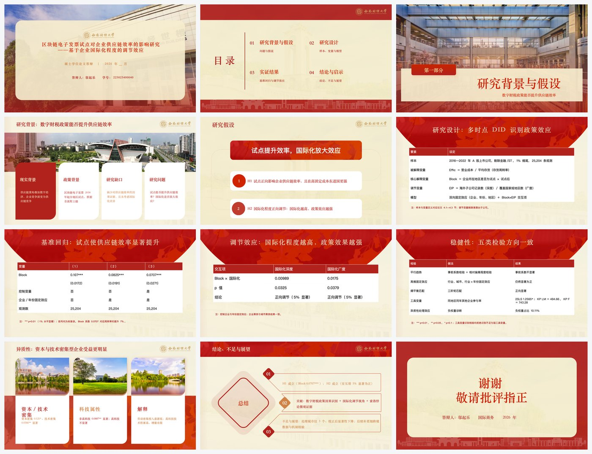

# 高校课程汇报 / 答辩 PPT Skill

> 输入「学校模板 + 论文/报告」，输出「像学校做的、能直接上台讲」的原生 pptx。
> 不是"帮你画 PPT"，是**模板翻译器 + 内容压缩器 + 质量门禁**。

## 这个 Skill 解决什么问题

高校学生做汇报 PPT 的真实痛点不是"不好看"，而是：

1. **学校模板不会用**：官方模板通常只有 4–8 页（封面/目录/章节/致谢），没有"研究方法""实验结果"版式，学生只能硬套三栏，把不同板块塞进一页；
2. **论文不会压缩**：几万字论文要压成 15 分钟 / 15 页，多数人直接搬摘要；
3. **交付不合格**：文件 200MB 传不出去、字体缺失、投影看不清、占位符没删干净。

本 Skill 的三条主线：**忠实复用学校模板**、**把论文压成"一页一论点"**、**交付前跑确定性质检**。

## 快速开始

```bash
# 1. 环境
python3 -c "import pptx, PIL; print(pptx.__version__, PIL.__version__)"

# 1.5 抽论文结构（Step 2 辅助）
python3 scripts/digest_paper.py "论文.docx" -o work/digest

# 2. 模板画像（Step 3）
python3 scripts/inspect_template.py "学校模板.pptx" -o work/profile

# 2.5 生成计划骨架（Step 4 辅助）
python3 scripts/make_plan_skeleton.py copy.md --profile work/profile/template-profile.json -o out/plan-skeleton.json

# 3. 单页样张（Step 4，先只做一页）
python3 scripts/build_deck.py "学校模板.pptx" build-plan.json -o out/样张.pptx --only 4

# 4. 批量生成（Step 5）
python3 scripts/build_deck.py "学校模板.pptx" build-plan.json -o out/答辩.pptx

# 4.5 生成 HTML 预览（方便逐页看 + 带备注）
python3 scripts/make_preview.py out/答辩.pptx -o out/preview.html --notes

# 5. 质量门禁（Step 6）
python3 scripts/validate_deck.py out/答辩.pptx --scene bachelor --out out/qa-report.json
python3 scripts/optimize_pptx.py out/答辩.pptx -o out/答辩-压缩.pptx
python3 scripts/render_check.py out/答辩-压缩.pptx -o out/render --dpi 110 --montage
```

## 工作流：7 步 + 3 道确认门

```
Step 0 环境自检
Step 1 需求澄清（8 问）
Step 2 逐页文案稿 copy.md        ◀ 确认门 1（此时不看模板）
Step 3 模板画像 + 视觉方案        ◀ 确认门 2（版式服从内容）
Step 4 单页样张                  ◀ 确认门 3（golden page）
Step 5 批量生成
Step 6 质检门禁
Step 7 交付
```

核心原则：**内容先行 → 视觉后置 → 单页验证 → 批量生成**。
模板与内容不匹配时：保留视觉 token → 改造结构 → 删无关装饰 → 合成新页面，**内容一页不少、一页不并**。

## 目录结构

```
campus-defense-deck/
├── SKILL.md                    # 入口：流程、硬规则、命令
├── references/                 # 按步骤加载的操作手册
│   ├── content-first.md        # 逐页文案稿：格式、确认清单、反例
│   ├── pilot-page.md           # 单页样张：选页、确认、视觉基准
│   ├── scenarios.md            # 7 类场景骨架、时长、评委关注点
│   ├── template-profile.md     # 模板解析协议与画像字段
│   ├── clone-and-compose.md    # 三条生成路径、克隆实现、合成版式
│   ├── content-distill.md      # 压缩规则、断言式标题、信息预算
│   ├── academic-visual.md      # 字号/图表规范、字体替换、学术红线
│   ├── speaker-and-qa.md       # 讲稿、时长配平、Q&A 预案（按需交付）
│   └── checklist.md            # P0/P1/P2 交付前自检
├── assets/
│   ├── fallback-template.pptx  # 无学校模板时的"学术极简"兜底模板（8 页样张）
│   ├── fallback-profile/       # 兜底模板画像（直接查 shapeId）
│   ├── font-fallbacks.json     # 中文字体替换表（Win / macOS / 渲染映射）
│   └── gates-template.md       # 三道确认门记录模板
├── scripts/
│   ├── inspect_template.py     # 模板画像：角色/实际用色/字体/样张骨架/污染
│   ├── build_deck.py           # 克隆样张 + 文本替换 + 图表/表格合成（--only 单页）
│   ├── validate_deck.py        # 结构校验（P0：污染/字数/字号/页数/体积）
│   ├── optimize_pptx.py        # 媒体降采样与重打包（实测 73MB → 2.8MB）
│   ├── render_check.py         # 渲染质检 + 拼图 + 字体映射
│   ├── digest_paper.py         # 论文 → 结构化摘要（章节/图表/关键句）
│   ├── make_plan_skeleton.py   # copy.md → 构建计划骨架（自动选样张 + 冲突报警）
│   ├── check_plan.py           # 内容覆盖检查：槽位守恒（缺内容即失败）
│   ├── gate_check.py           # 三道确认门校验（未过门阻止生成）
│   ├── make_preview.py         # pptx → 单文件 HTML 预览（带备注，可分享）
│   └── make_fallback_template.py
├── docs/
│   └── design-notes.md         # 设计取舍与两套学校模板实测记录
└── examples/
    ├── mib-course-paper/       # 一篇硕士论文的完整中间产物（文案稿/视觉方案/计划）
    ├── template-profile-sample/ # 模板画像样例（真实学校模板的解析结果）
    └── sample-deck.jpg         # 成品示例：12 页答辩 deck 拼图
```

## 示例成品

用西南财经大学【典雅红】模板 + 一篇硕士论文生成的 12 页答辩 deck（完整中间产物见 `examples/mib-course-paper/`）：



## 已验证的事实（来自实测）

| 结论 | 证据 |
|---|---|
| 中文高校模板的版式是空壳，装饰画在页面上 | 两套西财模板：`add_slide(layout)` 只得白页 |
| 主题色 ≠ 品牌色 | 典雅红 theme 仍是 Office 蓝，实际红 `B1221C` 出现 186 处 |
| 只能克隆样张，不能套版式 | 克隆后封面/图文/图表页视觉与原模板一致 |
| 体积必须治理 | 单张装饰图 42MB，模板 243MB；实测 73MB → 2.8MB（-96%） |
| 模板正文常为 12pt | 投影偏低，需在样张阶段决定"保模板"还是"改版式" |
| 字体缺失会静默回退 | macOS 缺微软雅黑/思源宋体，渲染回退到 PingFang SC |

## 状态

- ✅ V0.1 技术验证（模板画像 / 克隆生成 / 渲染质检 / 体积治理）
- ✅ V0.2 内容流程（文案先行 + 单页样张，已在 MIB 课程论文上跑通）
- ✅ V0.3 Skill 结构补齐：9 份 references + 8 个 scripts + 2 个 assets（兜底模板、字体表）
- ✅ V0.4 两个搬砖脚本：`digest_paper.py`（论文 → 章节/图表/关键句摘要）、`make_plan_skeleton.py`（copy.md → 计划骨架，自动选样张 + 条数/槽位冲突报警）
- ⏳ 待做：论文 docx → 文案稿 → build-plan 的全自动生成（目前由 Agent 按 references 手工撰写）

## 已知边界

- 模板只支持 `.pptx`；只有 PDF/图片版式的模板暂不支持（会提示用户找不到可克隆样张）；
- 正文 12pt（模板原生）与投影可读 18pt 冲突时，默认**保模板**，并在样张确认阶段由用户决定是否改版式；
- 渲染用 LibreOffice，换行/行距与 PowerPoint 可能有差异，交付前需在目标机复核；
- 不生成、不美化实验数据图；不代写核心结论（见 `references/academic-visual.md`）。
